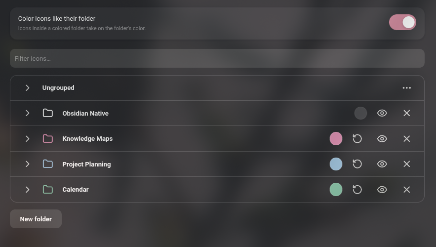

# Ribbon Drawers

Organise Obsidian's ribbon into collapsible folders.

<table align="center">
	<tr>
		<th>Before</th>
		<th>After</th>
	</tr>
	<tr>
		<td align="center"></td>
		<td align="center"></td>
	</tr>
</table>

## Features

- Group ribbon icons into folders.
- Give each folder an optional color.
- Drag icons directly in the ribbon to reorder them, move them between folders or out of a folder
- Hide any icon, or a whole folder, from the ribbon.

## Usage

Open **Settings -> Interface -> Ribbon menu configuration**, or right-click an empty part of the ribbon and choose **Organise ribbon…** There you can create, rename, color, hide and delete folders, and drag icons and folders into place.

While the plugin is enabled it manages the ribbon's order and visibility in place of Obsidian's built-in ribbon settings. Disabling it leaves the ribbon in the order you arranged, without folders.

**IMPORTANT FOR REVIEW: This plugin overrides Obsidian's native functionality**

## Compatibility

Desktop only. Requires Obsidian 1.13 or later.

## Installation

Install **Ribbon Drawers** from **Settings -> Community plugins -> Browse**, then enable it.

To install manually:

Copy `main.js`, `manifest.json` and `styles.css` from the latest release into `<vault>/.obsidian/plugins/ribbon-drawers/`.
